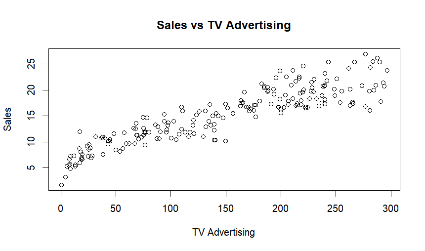
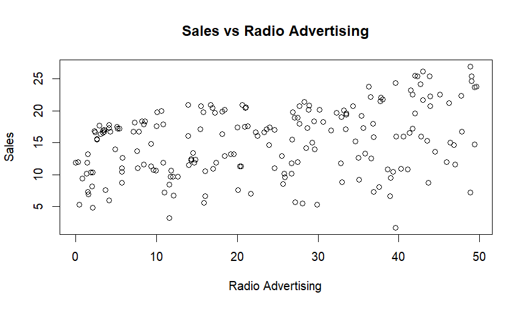
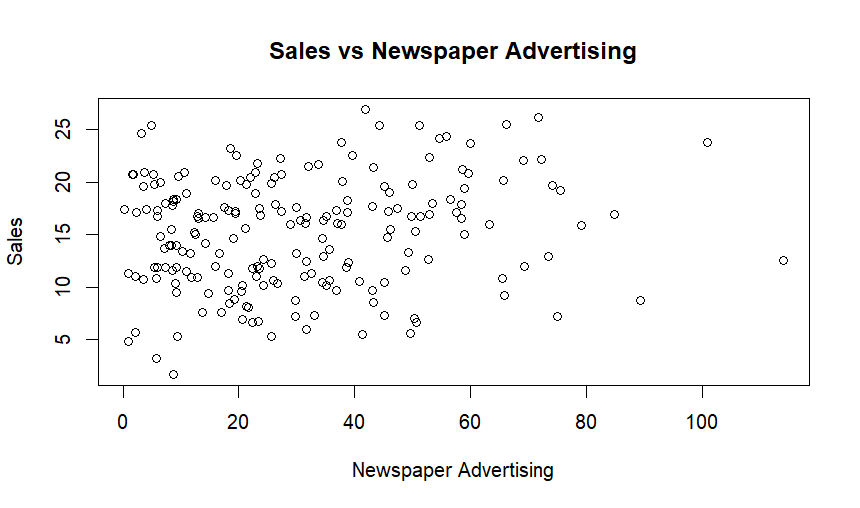

# Advertising Effectiveness Analysis Using R

An R-based statistical analysis examining how television, radio and newspaper advertising expenditure relates to product sales. The project combines exploratory data analysis, hypothesis testing and regression modelling to support evidence-based marketing decisions.

## Project overview

**Business question:** How do advertising spending levels across TV, radio and newspaper channels relate to product sales, and what can the results tell marketing managers about budget allocation?

The analysis uses a public advertising dataset containing **200 observations** with four variables: `TV`, `Radio`, `Newspaper` and `Sales`. Advertising spending is measured in thousands of US dollars and sales in thousands of units.

## Methods

- Descriptive statistics and distributions of advertising budgets and sales
- Correlation matrices, scatterplots and Pearson correlation tests
- Simple linear regression (sales predicted by TV spend)
- Multiple linear regression (TV, radio and newspaper spend)
- Model diagnostics, residual analysis and outlier/leverage checks
- Nested model comparison using ANOVA
- Welch's two-sample t-tests, one-way ANOVA and Tukey post-hoc comparisons
- Principal component analysis and hierarchical clustering

## Main findings

| Finding | Result from the analysed dataset |
| --- | --- |
| TV spending and sales correlation | Approximately **0.901** |
| Radio spending and sales correlation | Approximately **0.350** |
| Newspaper spending and sales correlation | Approximately **0.158** |
| TV-only regression R-squared | Approximately **0.812** |
| Multiple regression R-squared | Approximately **0.903** |
| Multiple regression predictors | TV and radio were statistically significant; newspaper was not significant after controlling for the other channels |

These are **sample-level associations**, not proof that increasing advertising spend causes higher sales. The analysis does not establish causal effects or measure performance on a separate test set.

## Figures

### Sales versus TV advertising



### Sales versus radio advertising



### Sales versus newspaper advertising



## Repository files

```text
advertising-effectiveness-analysis-r/
├── advertising_effectiveness_analysis.R
├── Advertising_Effectiveness_Analysis_Report.pdf
├── README.md
├── assets/
│   ├── sales_vs_tv.png
│   ├── sales_vs_radio.png
│   ├── sales_vs_newspaper.png
│   └── hierarchical_clustering.png
├── data/
│   └── README.md
└── demo/
    └── analysis_presentation.mp4
```

The PDF contains the analysis and statistical findings. The video is a **presentation walkthrough**, not a screen recording of the R script running.

## Run the R analysis

1. Install **R** and optionally **RStudio**.
2. Download the public [Advertising dataset on Kaggle](https://www.kaggle.com/datasets/ashydv/advertising-dataset?resource=download). See [data instructions](data/README.md).
3. Save the CSV as `advertising.csv` in the repository root (beside the `.R` file).
4. Make the repository root your R working directory and open `advertising_effectiveness_analysis.R` in RStudio.
5. Run the script section by section. The `View(summary_table)` command opens an interactive data viewer in RStudio.

The script uses **base R and standard R packages**, with no third-party R package dependencies. Column names are case-sensitive in R; the input data must have the columns `TV`, `Radio`, `Newspaper`, `Sales` as expected by the script.

## Scope and limitations

The analysis evaluates associations in one dataset and assumes modelling conditions such as approximate linearity. Other factors including prices, promotions, seasonality and competitor activity are not included. Marketing recommendations should be validated with further data or controlled experimentation before being treated as causal effects.

## Technologies

R, RStudio, regression analysis, hypothesis testing, exploratory data analysis, statistical visualisation, PCA, hierarchical clustering.

## Data attribution

Advertising dataset. [Kaggle, ashydv](https://www.kaggle.com/datasets/ashydv/advertising-dataset?resource=download). The CSV is not bundled with this repository.

## Author
Mohamed Hassanien
